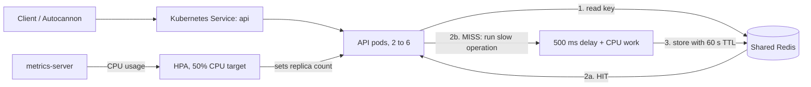

# Performance & Elasticity: Caching and Auto-Scaling

An Express/TypeScript API with a shared Redis cache (cache-aside) and a Kubernetes Horizontal Pod Autoscaler, running on Minikube.

**Live URL:** N/A (local Minikube)

## Architecture and cache flow



## Prerequisites
Windows PowerShell, Docker Desktop, Minikube, kubectl, Node.js

## Run guide

Start the cluster and enable metrics:

```powershell
minikube start --driver=docker --cpus=4 --memory=4096
minikube addons enable metrics-server
```

Build and deploy the API, Redis, and HPA:

```powershell
minikube image build -t week09-api:v1 .
kubectl apply -f k8s/
kubectl get pods
kubectl get hpa
```

Open a tunnel in a separate window and keep it open:

```powershell
minikube service api --url
```

Test the cache (replace `PORT`):

```powershell
curl.exe -i http://127.0.0.1:PORT/api/data/1
curl.exe -i http://127.0.0.1:PORT/api/data/1
kubectl exec deploy/redis -- redis-cli KEYS "*"
kubectl exec deploy/redis -- redis-cli TTL data:1
```

Run the load test, watching the autoscaler in another window:

```powershell
npm ci
$env:TARGET_URL = "http://127.0.0.1:PORT"
npm run load
```

```powershell
kubectl get hpa api -w
```

## AI disclosure and prompt appendix

**Tool:** Claude. It generated the initial draft (preserved in `ai-draft/`), guided the audit, wrote the corrected code and commands, and drafted this README.

### Prompt used for the initial draft

```text
Act as a senior cloud infrastructure and scalability architect. Build a high-performance, auto-scaling web application with an external distributed caching layer.

Requirements:
1. Web service in Node.js with TypeScript (Express): GET /api/data/:id simulates an expensive operation (500ms delay plus some CPU-bound work). Use the Cache-Aside pattern with an external Redis instance. On a hit, return immediately with header X-Cache: HIT. On a miss, run the slow operation, store the result in Redis with a 60-second TTL, and return X-Cache: MISS.
2. Redis deployed as its own service in Kubernetes.
3. Auto-scaling on Minikube: a Deployment with CPU/memory requests and limits, metrics-server, and a HorizontalPodAutoscaler targeting 50% CPU utilization (min 2, max 6 replicas).
4. A load testing script using Autocannon.

Provide the source code, Dockerfile, Kubernetes YAML manifests, load testing script, and step-by-step Windows PowerShell commands to run and test it.
```

### Other prompts, in order

Pasted terminal output, code, and screenshots are omitted.

1. "could you help me with this assignment step-by-step? this is week 9 btw" (assignment attached; sent before the draft prompt)
2. "make a prompts.md file? what would I put in it?"
3. "I would assume it would crash" (answering an audit question, with `server.ts` pasted)
4. "not 50 because there would be a delay?"
5. "100m?"
6. "there would be a error because it'd be 60 and not 90, thereby taking longer"
7. "wait i didn't apply any fixes yet"
8. "how would i apply the fixes"
9. "ignroe it?" (about the Minikube tunnel notice)
10. "which one win 1 or win 2"
11. "same window?"
12. "what is missing in the readme"
13. "Also what do u mean other prompts, could you just put what i put in you earlier?"

### What the AI got right
- External Redis service, not a per-process cache
- Explicit 60-second TTL
- CPU and memory requests and limits
- `X-Cache: HIT` / `MISS` headers

### What was corrected

| Found | Why it matters | Fix |
|---|---|---|
| Redis failure returned 500 or blocked startup | A cache outage took down the API | Fall back to the slow operation; connect in the background |
| No stampede protection | Concurrent misses repeated the same work | Share in-progress work (per pod) |
| CPU request of 100m | Scaling began at about 50m | Raised to 200m (about 100m) |
| 60-second scale-down window | Risk of pods flapping | Raised to 120 seconds |

## QA test summary

| Check | Result |
|---|---|
| Cache miss | `X-Cache: MISS`, 564 ms (`/api/data/2`) |
| Cache hit | `X-Cache: HIT`, 4 ms (`/api/data/2`) |
| Redis inspection | `data:1` present, TTL 45 s |
| Baseline | 2 API pods |
| Load test | 50 connections, 120 s, about 6k requests, 46 req/s average |
| Load latency | Median 1328 ms, 99th percentile 1984 ms |
| Scale-up | HPA reached 6 replicas (CPU above target) |
| Scale-down | 6, 5, 4, 3, then 2 replicas |
| Pod restarts | 0 on the pods remaining after the test |
| Browser DevTools check | `/api/data/5`: three requests, all status 200, 5 to 9 ms; inspected response showed `X-Cache: HIT` |
| Container log check | Brief `ECONNREFUSED` messages around API startup, with no later errors shown; Redis saves succeeded; no crash loops |
